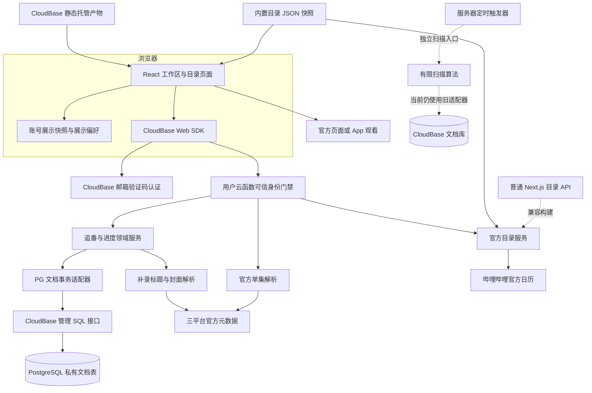
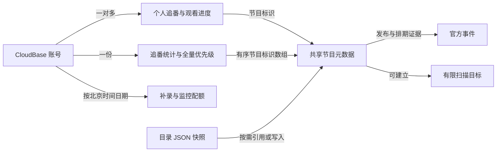
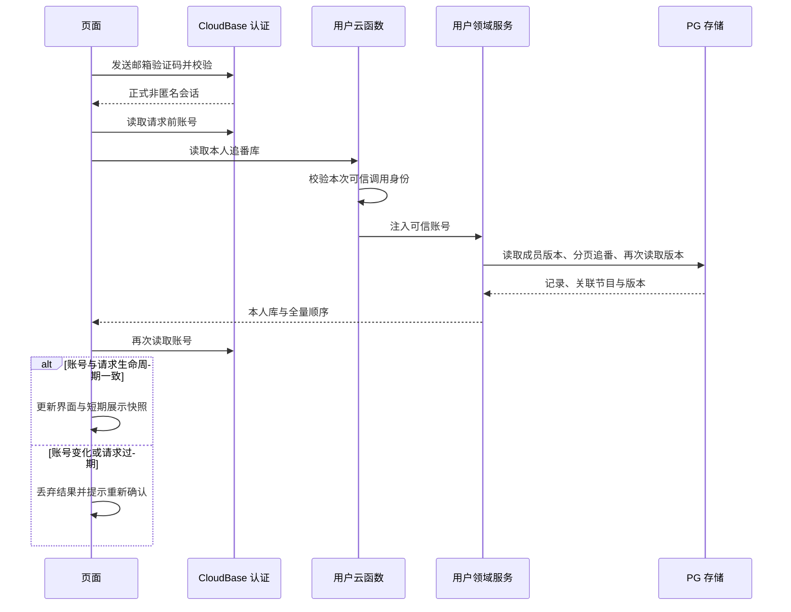
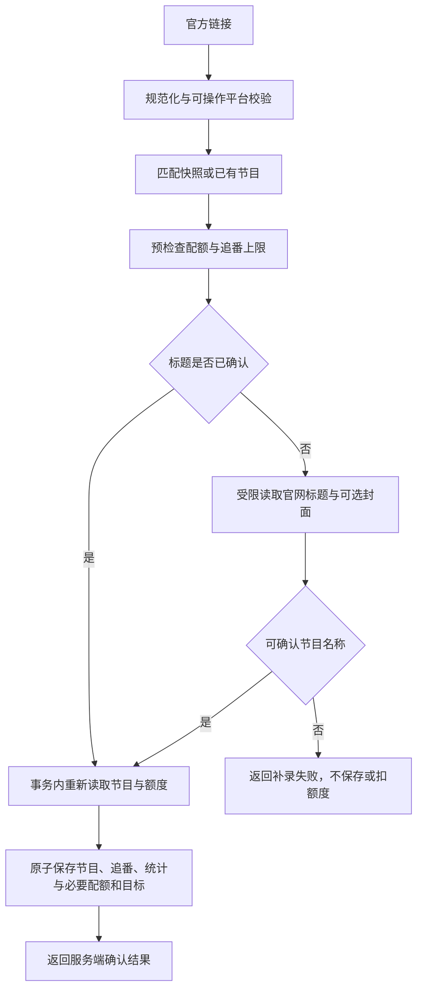
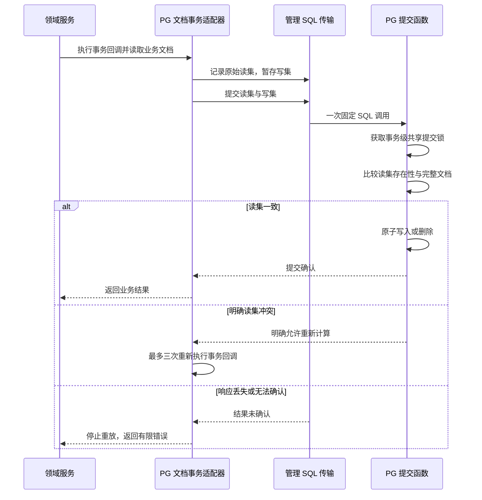

# GuomanTracker 系统设计与架构总览

## 重点

- **系统定位**：聚合国漫官方目录与排期，保存个人追番、优先级和手动观看进度，
  最终跳转官方平台观看；不采集、下载或托管音视频。
- **主架构**：Next.js / React 页面通过 CloudBase 邮箱认证调用用户云函数，
  云函数经管理 SQL 接口访问 PostgreSQL 私有存储。
  普通 Next.js 构建和 CloudBase 静态导出共用源码。
- **数据分层**：内置目录快照、账号追番记录、官方发布证据各有来源。
  个人数据由可信调用身份隔离，排期不自动转化为已发布集数或已看进度。
- **一致性机制**：服务层使用进度版本、成员版本和排序版本防止覆盖；
  存储层通过读集校验与原子提交处理竞争，结果未确认时停止自动重放。
- **落地边界**：用户链路已接入 PG，扫描入口仍依赖旧文档库适配器。
  本轮确认源码与本地测试状态，不将扫描算法、部署包或历史发布提交等同于线上运行验收。

## 一、文档范围与证据基线

本文是当前实现的架构快照，供维护者理解模块关系、定位业务入口与判断交付边界。
依据仅为源码、配置模板、测试、当前本地产物和 Git 元数据，
不以旧设计、旧实施计划或旧验收文档作为事实来源。
这是整体架构总览，不新增产品需求或实施任务。

| 项目 | 本次基线 |
| --- | --- |
| 核对日期 | 2026-10-13，北京时间 |
| 源码提交 | `2143b49d6c93dbf8626b21612466c280e44a32f3`，本文新增前的 `main` |
| 网站包版本 | `0.2.2`，来自 `guoman-site/package.json` |
| 本轮执行 | 198 项测试通过；TypeScript 类型检查通过 |
| 执行环境 | 本机 Node.js `v25.5.0`；CI 配置使用 `22.21.1` |
| 本地产物 | 静态首页和用户云函数部署包存在；本轮未重新构建 |
| 线上证据 | 未重新调用线上云函数、检查实际数据库或进行真实邮箱会话验收 |

后文“已实现”“已接入”表示当前源码包含对应调用与处理逻辑；
“测试通过”表示本轮本地自动化结果；
发布历史与线上现状另列，不混用证据。

## 二、系统边界与整体架构

### 2.1 业务边界

系统提供精准抽卡、我的追番、新番周历和国漫合集四个工作区，
默认进入精准抽卡。推荐以用户追番、可靠最新集数和未看内容为基础，
按账号优先级组织候选；它是确定性排序，不是模型推理推荐。

当前可操作平台为哔哩哔哩、腾讯视频与优酷。
平台白名单由前后端共用；历史不支持平台记录可以保留并取消追番，
但不进入推荐和新进度操作。源码保留微信授权兼容路径，当前页面入口使用邮箱验证码。

本地目录快照共 3,250 条，其中哔哩哔哩 3,218、优酷 16、腾讯视频 11、
爱奇艺 5；可操作平台范围内为 3,245 条。
这些是快照条目数量，不代表跨平台去重后的作品总数，
也不代表所有平台均被完整收录。
快照核验时间为 2026-10-05 00:31:11（北京时间）。

### 2.2 运行架构图

下图区分浏览器、认证、用户业务、数据库与外部官方平台。
虚线表示兼容或尚未接入当前 PG 主链路的部分。



目录读取和单集解析都先通过云函数身份门禁，随后在创建 PG 客户端之前返回，
所以这两个只读动作不依赖个人数据库访问。
浏览器不持有管理 SQL 凭证，个人记录也不通过浏览器直接读取数据库。

### 2.3 两条构建与目录读取路径

| 运行方式 | 页面产物 | 目录读取 | 个人记录 |
| --- | --- | --- | --- |
| 普通 Next.js | `.next` | `/api/catalog`（公开目录接口） | 用户云函数 |
| CloudBase 静态模式 | `.cloudbase-static/out` | 登录后调用用户云函数 | 用户云函数 |

`next.config.ts`（Next.js 构建配置）根据静态构建标记启用静态导出，
并指定目录传输方式。
`build-cloudbase-static.mjs`（静态构建脚本）复制源码到临时目录，
仅在副本中排除动态目录接口，复用依赖和共享领域模块后执行构建。
它不会通过删除原始接口文件来切换构建方式。

静态模式游客浏览内置快照，登录后才能同步官方日历；
普通 Next.js 模式允许通过公开接口同步。
双构建改变的是托管和目录传输方式，个人记录始终使用同一用户云函数契约。

## 三、模块职责与依赖方向

### 3.1 前端模块

以下路径均相对于仓库根目录。

| 模块路径 | 职责 |
| --- | --- |
| `guoman-site/app/page.tsx` | 读取内置快照并挂载页面入口 |
| `guoman-site/app/tracker.tsx` | 组织四个工作区、认证恢复、写操作、弹窗与账号生命周期 |
| `guoman-site/app/catalog.tsx` | 目录同步、搜索筛选、分页和个人周历展示 |
| `guoman-site/components/anime-collection.ts` | 复用作品项、列表、大图和展示切换控件 |
| `guoman-site/components/recommendation-deck.tsx` | 展示推荐卡组与候选操作 |
| `guoman-site/hooks/use-anime-display-mode.ts` | 同步浏览器展示偏好，处理存储失败和服务端首屏默认值 |
| `guoman-site/lib/cloudbase-client.ts` | 初始化 SDK，封装用户函数调用和认证入口 |
| `guoman-site/lib/cloud-auth.ts` | 校验非匿名会话、验证码结果和业务响应 |
| `guoman-site/lib/library-identity.ts` | 将读取结果绑定到前后均一致的 SDK 账号身份 |
| `guoman-site/lib/library-operation.ts` | 区分保存成功、刷新失败、明确拒绝和结果未知 |
| `guoman-site/lib/library-snapshot.ts` | 按账号保存短期展示快照，改善恢复体验 |
| `guoman-site/lib/watching.ts` | 计算未看队列、统计、推荐与排序 |
| `guoman-site/lib/weekly-schedule.ts` | 按北京时间组织本周排期与待核验节目 |
| `guoman-site/lib/personal-catalog.ts` | 合并个人节目资料与公共目录排期，保留个人节目身份 |
| `guoman-site/lib/catalog-transport.ts` | 统一 HTTP / 云函数目录响应的结构校验 |
| `guoman-site/lib/episode-playback.ts` | 预留新标签页，校验单集结果并跳转官方链接 |

页面组件负责编排交互；领域计算和异常状态分类放在独立模块中。
进度规范、已发布集数判定与平台白名单直接复用服务端同目录下的纯模块，
避免前后端使用两套含义不同的规则。

### 3.2 云函数与领域模块

| 模块路径 | 职责 |
| --- | --- |
| `cloudbase/functions/guoman-user/index.js` | CommonJS 云函数启动桥接 |
| `cloudbase/functions/guoman-user/entry.mjs` | 装配目录快照、目录服务和每次调用的管理客户端 |
| `cloudbase/shared/pg-user-handler.mjs` | 可信身份门禁、只读动作分流和 PG 业务装配 |
| `cloudbase/shared/invocation-identity.mjs` | 从本次调用上下文读取明确非匿名身份 |
| `cloudbase/shared/user-service.mjs` | 追番、补录、限额、进度、账号顺序与并发规则 |
| `cloudbase/shared/pg-store.mjs` | 文档读写、事务读集与写集、冲突重试和结果未确认处理 |
| `cloudbase/shared/pg-management-transport.mjs` | 固定 SQL 调用、响应校验、分页和请求内关联节目缓存 |
| `cloudbase/shared/catalog-service.mjs` | 官方日历读取、快照合并、缓存、并发合并和回退 |
| `cloudbase/shared/submission-metadata.mjs` | 仅确认补录节目标题与可选封面 |
| `cloudbase/shared/episode-links.mjs` | 从官方正片数据解析指定集数真实链接 |
| `cloudbase/shared/official-url.mjs` | 校验并规范化节目 URL，限制协议、域名和路径 |
| `cloudbase/shared/official-links.mjs` | 在规范链接上生成稳定 SHA-256 标识 |
| `cloudbase/shared/episode-progress.mjs` | 统一进度表示、旧数据转换与有效性校验 |
| `cloudbase/shared/published-episode.mjs` | 从可靠字段和已发生事件提取最新已发布集数 |
| `cloudbase/shared/platform-support.mjs` | 定义可操作平台白名单 |
| `cloudbase/shared/scanner.mjs` | 受限网络读取和有限扫描算法；读取器也用于补录及单集解析 |

`createUserService`（创建用户领域服务）接收存储、目录快照、时间和元数据解析器，
不直接依赖云平台 SDK。
`createPgUserHandler`（创建 PG 用户函数处理器）把可信身份与具体基础设施接入它。
这种依赖注入使领域测试可以覆盖竞争、失败和时间边界，
但测试替身不能证明真实云服务或 SQL 迁移已经可用。

### 3.3 数据采集、打包与非主链路目录

- `guoman-site/scripts/collect-catalog.py`（目录采集脚本）读取 B 站国创索引和日历，
  生成快照并保留其他平台条目。
  `collect-platforms.py`（其他平台采集脚本）补充其余平台资料。
  它们是离线快照生产工具，不是浏览器请求期间的全量采集任务。
- `guoman-site/scripts/prepare-cloudbase.mjs`（云函数打包脚本）复制函数、共享模块、
  锁定依赖和用户函数目录快照，并重写相对导入到包内路径。
  生成两个部署包不意味着两个入口均适合部署。
- `cloudbase/functions/guoman-scan/entry.mjs`（定时扫描入口）仍调用文档库事务，
  未接入 PG 存储协议；用户服务写入扫描目标也不等于定时任务已运行。
- `guoman-site/db`、`examples/d1` 和连接器辅助模块保留了模板或可选能力。
  当前追番入口没有调用 D1 数据库；不能仅凭依赖和目录存在，
  将 D1、Drizzle 或连接器计入当前个人记录主架构。

## 四、核心数据模型

### 4.1 逻辑实体关系

下图表示业务关系；账号由 CloudBase 管理，其他节点不是独立关系表。



用户可以共享同一节目元数据，但每个人的进度、暂停状态、优先级和配额独立。
追番记录与节目之间的关联由服务代码维护，当前没有独立的关系外键约束。

### 4.2 PG 物理存储

迁移源码定义一张 `guoman_private.documents`（私有文档表），
通过 `collection`（逻辑集合名）与 `id`（文档编号）构成联合主键，
`document`（业务文档）以 JSONB 保存。
文档内的 `_id`（存储文档编号）必须与主键编号一致。
所以“三个集合”是同一 PG 表内的三个命名空间，不是三张关系表或三个文档数据库。

| 逻辑集合 | 内容 |
| --- | --- |
| `guoman_series`（节目集合） | 共享节目资料及核验状态 |
| `guoman_watch_state`（个人状态集合） | 追番、统计、补录配额、监控配额 |
| `guoman_monitor_targets`（监控目标集合） | 用户或管理员明确选入的有限扫描目标 |

迁移为追番记录建立按所属账号与文档编号检索的部分索引，
启用并强制行级权限，同时撤销普通匿名和认证角色对私有对象的访问。
该策略允许指定后端角色访问；它不是基于最终用户编号的逐行隔离策略。
**最终用户隔离由云函数可信身份与服务层所属账号校验共同完成。**

SQL 函数只有三类业务访问入口：

- `get_document`（读取文档）：按集合与编号读取单个文档。
- `list_follows_page`（分页读取追番）：按账号过滤，每页最多 100 条，
  同时返回关联节目，使用稳定编号游标继续读取。
- `commit_documents`（提交文档事务）：验证读集仍然成立后，原子应用写集。

另有 `assert_backend`（核对后端身份）在 SQL 内检查运行角色和数据库。
迁移文件有固定目标校验，不能当作任意环境可重复执行的通用建库脚本。
本轮仅核对定义，没有重新执行迁移或检查云端有效权限。

### 4.3 节目与发布事件

`Anime`（节目类型）由目录与个人节目资料共用，主要字段如下。

| 字段 | 含义与作用 |
| --- | --- |
| `id` | 节目标识，连接追番记录、优先级和监控目标 |
| `title` / `platform` | 节目名称与平台编号，用于展示、筛选和平台校验 |
| `url` / `cover` | 官方节目链接与封面地址；不存储视频内容 |
| `status` / `episodes` | 连载状态与集数说明；集数说明须经过规则才能作为发布证据 |
| `checkedAt` / `source` | 资料核验时间与来源；核验时间不是发布时间 |
| `events` | 官方事件数组，表达具体时间的发布或排期信息 |
| `days` / `time` / `schedule` | 固定星期、更新时间和排期文字，用于计划展示 |
| `scheduleCheckedAt` | 排期证据自己的核验时间，防止新标题刷新旧排期有效期 |
| `latestEpisode` | 已确认的最新正片集数；未知时不能自行猜测 |
| `metadataPending` | 标记尚未确认的节目资料，补录时据此判断是否需要修复 |
| `monitoring` | 核验状态：等待、运行、需人工核验或失败 |
| `lastScanAt` / `lastScanAttemptAt` | 成功核验时间与失败尝试时间，分别记录 |
| `nextScanAt` / `scanError` | 下次扫描时间与有限诊断信息，不证明扫描器已启用 |

事件字段 `at`（事件时间）为毫秒时间戳，`label`（事件标签）记录集数等文字，
`published`（是否发布）与 `delayed`（是否延期）约束发布判定。
时间已到但没有可靠发布标记，仍不能当作已上线正片。

B 站快照使用季标识；新补录通常使用规范链接的哈希标识。
补录先匹配内置快照规范链接，有匹配时复用原编号。
去重依据是规范链接，不是节目名称，也不保证识别所有不同链接指向的同一作品。

### 4.4 个人进度与账号顺序

`WatchState`（观看状态类型）对外不返回存储所属字段；
持久化时还包含 `owner`（所属账号）与 `kind`（文档用途）。

| 字段 | 含义与作用 |
| --- | --- |
| `seriesId` | 关联的节目标识 |
| `currentEpisode` | 正在看或最近看完的一集；0 表示尚未开始 |
| `episodeCompleted` | 当前这一集是否完整看完 |
| `paused` | 是否暂停追番；暂停后不进入观看推荐 |
| `updatedAt` | 最近一次进度保存时间 |
| `lastOpenedAt` | 最近打开官方平台的时间，不代表看完 |
| `version` | 进度并发版本，每次成功修改进度递增 |

例如第 10 集尚未看完时，当前集为 10，完成标记为假，完整看完数为 9；
第 10 集看完后，完整看完数为 10。
`normalizeEpisodeProgress`（统一进度表示）兼容转换旧“已看集数加秒数”数据，
新业务不继续以秒数记录续看位置。

同一账号的统计文档包含：

| 字段 | 含义与作用 |
| --- | --- |
| `followCount` | 追番数量，用于 500 部上限控制 |
| `priorityOrder` | 全量追番节目标识的有序数组，包括界面隐藏的记录 |
| `membershipVersion` | 成员版本，真正新增或删除追番时递增 |
| `orderVersion` | 排序版本，每次成功重排时递增 |

追番文档编号由账号和节目标识的组合哈希生成；
统计文档按账号生成，配额文档按账号和北京时间日期生成。
哈希编号用于稳定寻址，不替代授权或所属账号校验。

### 4.5 配额与监控目标

个人状态集合通过 `kind`（文档用途）区分 `follow`（追番）、
`stats`（统计）、`quota`（新节目补录配额）和
`scan-quota`（新增监控目标配额）。
配额的 `day`（北京时间日期）与 `count`（使用次数）参与事务校验。
当前上限为每账号每日 10 部全新补录、20 个新增监控目标、最多追番 500 部。
已有节目或已有监控目标按实际新增条件判断，不一律扣额度。

监控目标记录 `seriesId`（节目关联）、`url`（规范官网链接）、
`platform`（平台）、`source`（用户或热门来源）、`status`（处理状态）、
`nextScanAt`（下次到期时间）、`failureCount`（连续失败次数）和
`leaseUntil`（执行租约截止时间）。
当前用户链路可写入目标；租约领取与扫描状态推进仍位于旧文档库扫描入口。

## 五、接口契约与关键业务调用链

### 5.1 用户云函数统一接口

`cloudCall`（调用用户云函数）发送 `action`（业务动作）和
`payload`（业务参数）。调用前检查 SDK 正式会话，
可用 `expectedUserId`（预期当前账号）阻止账号切换后的旧请求。
这个前端检查是交互保护；后端授权仍独立读取可信调用身份。

成功响应使用 `ok`（是否成功）和 `data`（业务结果）；
失败响应使用 `error.code`（可识别的业务错误码）与
`error.message`（可展示的有限说明）。

| 动作 | 含义 | 关键输入或结果 |
| --- | --- | --- |
| `getCatalog` | 同步公共目录 | 空参数；返回节目和实时标记；不访问 PG |
| `resolveEpisode` | 查找官方单集 | 官方链接与整数集号；返回真实单集链接；不访问 PG |
| `library` | 读取本人追番库 | 返回账号、节目、追番、全量顺序及两个账号版本 |
| `submit` | 补录官方链接并追番 | 仅以官方链接为输入，服务端确认标题后保存 |
| `follow` | 追番已知节目 | 传节目标识；按需写入节目、统计和监控目标 |
| `unfollow` | 取消追番 | 删除本人追番并维护统计与全量顺序 |
| `progress` | 保存手动观看进度 | 当前集、完成标记、暂停状态及预期进度版本 |
| `reorder` | 保存全量优先级 | 全量节目标识及预期成员、排序版本 |
| `open` | 记录打开官方平台 | 仅更新打开时间，不推进进度 |

### 5.2 登录、恢复与读取个人记录

下面的链路通过读取前后两次会话核对，避免把其他账号的迟到结果放到当前界面。



`readInvocationIdentity`（读取本次调用身份）只接受调用上下文自己的数据字段，
要求账号编号合法且匿名标记明确为假。
现代上下文字段存在但无效时，不退回旧格式绕过校验。
它不使用请求体中的账号编号，也不依赖跨请求缓存的身份。

`library`（读取追番库）用“读统计—列出追番—再读统计”核对成员版本，
不一致最多尝试三次，再返回冲突。
这是成员集合的一致性保护，不是所有节目和进度在同一瞬间的数据库快照。
分页关联节目缓存仅用于本次只读调用，避免每部追番再单独读取节目。

展示快照存于 `sessionStorage`（当前浏览器页面会话存储），按账号隔离，
有效期 15 分钟；只有 SDK 身份确认后才读取，不用于授权写入。
退出成功后清理，退出失败保留原账号状态。

### 5.3 目录同步与个人周历

`loadCatalogData`（读取目录）选择公开 HTTP 接口或认证云函数动作，
统一通过结构校验后交给页面。
`createCatalogService`（创建官方目录服务）加载三平台快照，
读取固定 B 站国创日历接口，再合并事件与新出现的节目。

读取限制为 10 秒、2 MiB，以及有限天数和事件数量。
成功结果按服务实例缓存 10 分钟，并合并进行中的并发请求；
上游失败返回快照且实时标记为假，不缓存失败为成功。
这里“实时”包含有效缓存结果，不意味着每次访问都重新抓取。
普通 HTTP 接口另对成功响应设置 5 分钟浏览器缓存，回退响应禁止缓存。

页面仅在实时标记为真时替换当前目录；失败时保留已有展示并提示。
个人周历使用 `followedCatalog`（合并已追番目录）保留个人编号，
按编号或规范链接关联公共资料，单独选择排期证据。
仅标题更新的较新记录不能抹除已知事件，也不能让过期固定排期续期。

**公共目录同步不会自动把事件写回 PG 个人节目文档。**
当前观看推荐使用个人追番库中的节目资料；
因此周历同步成功不等于全部个人推荐的最新集数都已刷新。

### 5.4 补录链接并加入追番

下面的流程把外部官网读取放在事务外，再在事务内复核存在性和额度。



`resolveOfficialMetadata`（读取官方标题资料）默认使用 5 秒超时、2 MiB 上限，
拒绝登录页、验证码页、通用品牌标题和非法跳转。
标题识别与最新已发布集数解析分离：确认节目名称并不证明最新集数。

事务内优先复用竞争期间已创建的节目，不用先前读取结果覆盖已经确认的资料。
全新节目先记录为集数待核验，同时建立有限扫描目标。
当前扫描器未接入 PG，因此“已补录且等待核验”不能表述为“已持续自动更新”。

### 5.5 保存进度与重排优先级

`progress`（保存进度）先校验本人追番、平台和集数边界，再比较进度版本。
存在可靠最新集数时，不允许超过它；未知时允许在 0 至 10,000 的范围手动记录。
第 0 集不能标记为已看完。版本一致后保存新进度并递增版本。

`reorder`（保存优先级）要求传入本人完整追番集合且每个编号仅出现一次，
最多 500 个；事务内再次比较成员版本和排序版本，最终只写一份账号统计文档。
这样不需要为一次排序逐条重写全部追番记录，避免超过单事务 128 个键的限制。
列表筛选开启时禁止重排，防止只保存可见子集而覆盖隐藏记录顺序。

前端 `perform`（统一执行写操作）使用同步互斥标记阻止同页重复提交，
使用请求代次与账号身份检查丢弃过期结果。
`runLibraryOperation`（归类写入与刷新结果）区分以下状态：

| 状态 | 界面处理 |
| --- | --- |
| 保存确认且展示可更新 | 使用确认补丁，或重新读取追番库 |
| 保存确认但刷新失败 | 提示已保存、展示待刷新，阻止继续写入 |
| 明确业务拒绝 | 展示具体原因；版本冲突要求重新读取 |
| 提交结果未知 | 保留记录，要求重新读取，不自动再提交 |

### 5.6 PG 事务提交协议

下图说明跨多次读请求计算的业务写集，如何最终在单次数据库提交中确认。



`createPgStore`（创建 PG 文档适配器）限制读写涉及的键数和请求体积。
`createManagementTransport`（创建管理 SQL 传输器）只调用固定函数名，
将参数 JSON 编码为十六进制，并验证多层 SQL 响应结构。
它不会把用户字符串直接拼接成任意 SQL，也不会自动重放不确定的提交。

数据库提交要求 READ COMMITTED（读已提交隔离级别），
使用同一把事务级 advisory lock（协作锁）串行保护提交窗口，
在获取锁后的独立语句中重新检查读集。
因此事务安全性依赖固定提交入口、角色权限、隔离级别和锁协议共同成立，
不能绕过协议直接更新表后仍假定相同的一致性保证。

### 5.7 跳转指定官方集数

`resolveOfficialEpisode`（解析官方单集）从三平台正片选集数据读取真实单集标识：
B 站根据正片编号与发布时间筛选；腾讯按官方选集模块及目标集数区间读取；
优酷读取页面内结构化数据，必要时通过官方末集入口读取后续区间。
它不执行网页脚本，也不通过拼接或猜测视频编号生成链接。

`openEpisodePlayback`（打开官方单集）在用户点击时预留空白标签页，
异步结果返回后再次核对集号、平台、域名和路径。
取消、账号切换或解析失败时关闭空白页；被浏览器拦截时提供确认后的链接。
解析失败则允许前往官方作品页自行选集。

成功打开后可调用 `open`（记录打开时间）；
它与 `progress`（确认观看进度）是独立动作。
是否唤起 App、是否自动播放、会员与地区权限由官方平台和设备决定。

## 六、领域规则与安全边界

### 6.1 发布、排期和观看事实分别处理

- **已发布集数**：`latestPublishedEpisode`（提取最新已发布集数）
  优先使用确认字段，也可读取明确更新说明、完结全集说明和已发生的发布事件。
  未来安排、预告、延期与计划总集数不能充当当前更新。
- **本周未看统计**：以北京时间周一零点至下周一零点为区间，
  只计算已经发生、明确发布、未延期且可识别正片集号的事件，按集号去重。
- **周历展示**：`weeklySchedule`（组织本周排期）优先使用具体事件，
  缺少当天事件时才使用有效固定排期，并明确标记为计划更新。
  固定排期有效期为核验后不足 30 天；待核验作品单独统计。
- **推荐队列**：`watchingQueue`（组织观看队列）排除暂停和不支持平台，
  分开处理未看、已追平与未知集数；完结但未看完仍可推荐。
  `orderedRecommendations`（按优先级排列推荐）在候选内优先使用账号全量顺序，
  再使用续看状态、拼音名称与编号作稳定比较。

推荐与周历在前端计算，保存进度时后端再次检查可写边界。
浏览器可以辅助展示，但不能单方面决定用户身份、额度或写入是否成功。

### 6.2 网络与身份边界

- 官方链接限定 HTTPS、域名和节目路径，拒绝凭据、非标准端口及任意网址。
  网络读取逐跳校验平台，限制超时、响应字节数和文本类型。
- 用户函数从本次调用上下文取身份；管理客户端在调用内创建，
  使用运行时短期凭证，不跨账号缓存凭证或个人记录。
- 目录成功缓存可以跨同一服务实例复用；个人节目关联缓存只存在于一次请求内。
- 函数权限模板要求用户函数非匿名调用，禁止客户端调用扫描函数；
  模板文件本身不能证明线上规则已经生效。
- 数据库故障返回有限业务错误，客户端不收到原始上下文、管理凭证或完整 SQL 错误。
  补录响应也不会暴露节目提交者。

## 七、主要技术取舍与代价

以下是从实现机制得出的取舍分析，不代表新增路线图或已记录的历史决策过程。

### 7.1 静态页面与云函数拆分，保留双构建

页面内容可以静态托管，认证和写入集中到用户云函数，
减少对页面服务器运行时的依赖；普通 Next.js 目录接口则保留兼容路径。
代价是维护两种目录传输、两套产物，并让静态模式实时目录依赖登录。

### 7.2 PG 中保留文档领域接口

领域服务使用集合与文档接口，PG 以 JSONB 承载，
避免将全部业务代码改写为关系查询。
分页返回关联节目减少读取追番库时的逐条网络往返。
代价是部分业务结构、关联和账号隔离依赖服务代码，
约束没有全部表达为强类型关系表与外键，后续分析查询也更复杂。

### 7.3 通过管理 SQL 入口访问私有存储

当前正式用户入口没有使用 TCP 数据库连接，
而是用 CloudBase 管理 SDK 执行固定 SQL 函数。
这样可以在现有访问方式下实现私有存储与原子提交。
代价是每次管理 API 往返的延迟、可用性与权限范围成为架构依赖，
必须严格限制函数名、参数编码、运行角色和返回数据。

### 7.4 全局提交锁与乐观业务版本并用

提交窗口串行化让跨文档写入协议较直接，
业务版本进一步防止陈旧客户端覆盖进度或排序。
代价是所有账号写入共享同一提交锁，高并发时可能等待或冲突重试；
该实现尚无本轮云端压力测试证明，不能由单元测试推断吞吐容量。

### 7.5 可靠证据优先于覆盖率

固定排期、最新发布、个人已看分别建模；
无法识别标题或单集时明确失败，不自动补造事实。
代价是第三方接口变化或限流时会出现待核验、补录失败、无法推荐等状态。
这使覆盖范围更保守，但避免把“应该更新”误写成“已经上线”。

### 7.6 限量扫描与按需目标

扫描算法每批最多 20 个目标、并发最多 3，用户目标优先，热门种子最多 30 个。
用户目标成功后基线间隔 6 小时，热门目标 24 小时，失败指数退避且上限 7 天，
已知集数不因失败回退。
这些策略控制外部请求规模，代价是元数据存在刷新延迟。
当前扫描存储尚未适配 PG，这些间隔是源码能力，不是已运行服务承诺。

### 7.7 保存确认与展示恢复分开

用服务端确认补丁减少不必要的整库重读，
用短期展示快照改善重新打开页面时的体验。
代价是必须维护请求生命周期、账号一致性和刷新阻塞状态。
结果未知时要求先重读而非自动重放，能避免重复写入，
但用户需要明确完成一次恢复操作。

## 八、实际落地状态与验证范围

### 8.1 当前实现状态

| 能力 | 源码与本地证据 | 本轮确认边界 |
| --- | --- | --- |
| 四个工作区、推荐、筛选与展示切换 | 主页面与共享组件已实现 | 非本轮浏览器布局验收 |
| 邮箱登录、恢复、退出与账号绑定 | SDK 调用与身份校验已接通 | 未发送邮件或登录真实账号 |
| PG 用户追番、补录、排序与进度 | 正式函数已选择 PG 处理器 | 未重新检查线上 SQL / 权限 / 真实写入 |
| 公共目录日历同步 | HTTP 与云函数共用目录服务 | 测试覆盖回退、限额、缓存及并发；未实测上游 |
| 官方指定集数跳转 | 三平台解析与客户端校验已实现 | 测试通过；未重新核验真实平台官网 |
| PG 迁移与提交协议 | SQL 源码和适配器完整存在 | 本地替身测试不等同真实 PG 执行验收 |
| 有限扫描算法 | 解析、选择、退避与权限算法有测试 | 算法已实现 |
| PG 定时扫描闭环 | 正式扫描入口仍使用文档库 | 尚未接入当前 PG 主链路 |
| 静态页面与云函数打包 | 本地产物存在，构建脚本完整 | 本轮未重建，不能据此确认云端版本 |
| D1、连接器与微信兼容路径 | 存在模板或兼容代码 | 不计为当前已验收主能力 |
| 通知、提醒、官方已看记录自动同步 | 当前主业务没有对应动作 | 不属于本轮已实现能力 |

### 8.2 本轮验证及其含义

本轮在当前源码执行与网站测试脚本相同的 Node.js 测试入口，
共 198 项通过、0 项失败、0 项跳过；另执行 TypeScript 无输出类型检查并通过。
测试覆盖身份门禁、PG 传输及事务替身、配额、并发版本、目录、官方解析、
进度、周边界、快照和展示组件等。

执行入口如下，工作目录为 `guoman-site`：

```sh
node --experimental-strip-types --test tests/*.test.ts ../cloudbase/tests/*.test.mjs
node node_modules/typescript/bin/tsc --noEmit
```

本机执行使用 Node.js `v25.5.0`，不代表已经在 CI 配置的 Node.js `22.21.1`
重新跑过同一轮检查。测试主要使用可控时间、网络响应与存储替身；
它们证明对应逻辑在覆盖场景内成立，不证明生产上游、云端数据库、邮件或跨账号会话可用。

CI 配置在 push / PR 时执行安装、测试、类型检查、普通 Next.js 构建和云函数打包。
目前 CI 没有执行 CloudBase 静态构建，也没有真实账号验收或云端数据库集成测试。
本轮不额外声称静态构建、lint 或发布检查通过。

### 8.3 发布证据与尚未确认的线上状态

Git 中存在 `2143b49`（记录 main 汇总发布与线上核验）及
`7fca06b`（记录 CloudBase 发布与真实账号验收）等提交，
说明仓库有发布记录；本文没有读取这些提交涉及的旧文档，
也没有用提交标题代替线上状态核验。

本地存在静态首页、认证兼容回调页以及用户函数部署包。
产物存在只能证明曾生成过文件，不能确认它们对应当前源码，
更不能确认远端已上传相同内容。

因此，本轮可以确认的是“用户链路已接入 PG、扫描链路尚未接入 PG、
198 项本地测试与类型检查通过”。
当前托管文件、云函数版本、SQL 对象及权限、真实账号读写和定时触发器的实际状态，
均未在本轮重新核验。

## 九、源码导航与维护重点

以下入口均指向源码或配置，不依赖旧文档；修改相应机制时可从这里开始追踪。

- **工作区与写入恢复**：
  [页面编排](../../guoman-site/app/tracker.tsx)、
  [写入结果分类](../../guoman-site/lib/library-operation.ts)。
- **会话与账号隔离**：
  [认证封装](../../guoman-site/lib/cloud-auth.ts)、
  [结果身份绑定](../../guoman-site/lib/library-identity.ts)、
  [可信调用身份](../../cloudbase/shared/invocation-identity.mjs)。
- **目录与周历**：
  [目录页面](../../guoman-site/app/catalog.tsx)、
  [目录服务](../../cloudbase/shared/catalog-service.mjs)、
  [个人目录合并](../../guoman-site/lib/personal-catalog.ts)、
  [周历计算](../../guoman-site/lib/weekly-schedule.ts)。
- **推荐与发布判定**：
  [观看队列](../../guoman-site/lib/watching.ts)、
  [已发布集数](../../cloudbase/shared/published-episode.mjs)、
  [进度规范](../../cloudbase/shared/episode-progress.mjs)。
- **追番、限额与排序**：
  [用户领域服务](../../cloudbase/shared/user-service.mjs)。
- **PG 存储协议**：
  [事务适配器](../../cloudbase/shared/pg-store.mjs)、
  [管理传输](../../cloudbase/shared/pg-management-transport.mjs)、
  [迁移 SQL](../../cloudbase/migrations/pg-private-v1/001-init.sql)。
- **正式函数装配**：
  [用户入口](../../cloudbase/functions/guoman-user/entry.mjs)、
  [PG 处理器](../../cloudbase/shared/pg-user-handler.mjs)。
- **补录与官方播放**：
  [标题解析](../../cloudbase/shared/submission-metadata.mjs)、
  [单集解析](../../cloudbase/shared/episode-links.mjs)、
  [浏览器跳转](../../guoman-site/lib/episode-playback.ts)。
- **扫描接入缺口**：
  [扫描入口](../../cloudbase/functions/guoman-scan/entry.mjs)、
  [扫描算法](../../cloudbase/shared/scanner.mjs)。
- **构建、打包与 CI**：
  [Next.js 配置](../../guoman-site/next.config.ts)、
  [静态构建](../../guoman-site/scripts/build-cloudbase-static.mjs)、
  [函数打包](../../guoman-site/scripts/prepare-cloudbase.mjs)、
  [CI](../../.github/workflows/check.yml)。

维护时优先保持以下边界：账号身份只能来自可信会话与调用上下文；
公开目录合并、排期与个人发布证据不能混为一体；
任何新写入路径都必须遵守提交协议和结果未知处理；
启用扫描前须完成 PG 存储适配与真实运行核验，不能直接部署旧入口。
